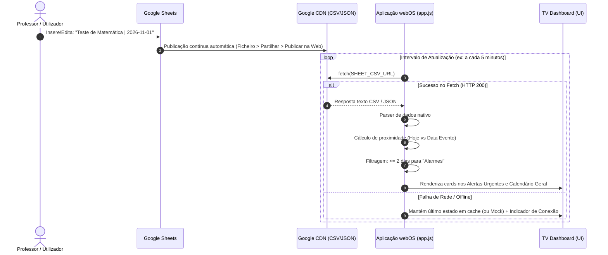

# 📐 Arquitetura do Projeto: Dashboard Escolar webOS

## 1. Visão Geral e Analogia Pedagógica

Desenvolver uma aplicação **TV-First** para LG webOS com backend descentralizado no Google Sheets pode ser comparado a um **Painel de Partidas de Aeroporto**:
- **Google Sheets (A Torre de Controlo / Base de Dados):** Onde os professores ou encarregados de educação inserem e atualizam datas de testes e TPCs de forma colaborativa, sem precisar de aceder a servidores ou bases de dados SQL complexas.
- **Google Sheets API / Exportação CSV/JSON (O Transmissor):** Publica uma vista estática e leve da folha de cálculo através de um URL HTTP público acessível em qualquer browser.
- **webOS Web Engine (O Ecrã Gigante / Consumidor):** A TV LG corre uma versão otimizada do motor Chromium. A aplicação cliente descarrega a folha a intervalos regulares (polling), processa a lógica temporal em memória e renderiza a interface a 1080p, visível a 3 metros de distância.

```
+---------------------+           +------------------------+           +----------------------+
|    Google Sheet     |           |    Public CSV / JSON   |           |      LG webOS        |
|  (Edição Docente)   | --------> | (Endpoint Web Público) | --------> | (Chromium Web Engine)|
|  Testes e TPCs      |  Publish  | docs.google.com/...    |   Fetch   | app.js -> DOM Render |
+---------------------+           +------------------------+           +----------------------+
```

---

## 2. Fluxo de Dados Detalhado (Passo a Passo)



### Passo 1: Fonte de Dados (Google Sheet)
A Google Sheet é configurada com cabeçalhos padronizados:
`Tipo, Disciplina, Titulo, Data, Hora, Descricao`
Exemplo:
`Teste, Matemática, Geometria Analítica, 2026-11-01, 10:00, Levar régua e calculadora`

### Passo 2: Publicação na Web (Sem Necessidade de Chaves de API Complexas)
Para manter a arquitetura resiliente, leve e sem dependência de OAuth ou quotas do Google Cloud:
1. No Google Sheets: **Ficheiro (File) > Partilhar (Share) > Publicar na Web (Publish to the web)**.
2. Seleciona-se o formato **CSV (Comma-separated values)** ou **TSV**.
3. O URL gerado retorna texto simples que o JavaScript no webOS consegue fazer `fetch()` sem custos e sem bibliotecas externas pesadas.

### Passo 3: Motor de Processamento no Cliente (`app.js`)
1. **Sanitização e Parse:** Converte as linhas CSV num array de objetos JavaScript.
2. **Normalização de Datas:** Converte strings de data (`YYYY-MM-DD`) para `Date` local, zerando as horas para evitar inconsistências de fuso horário no cálculo de dias restantes.
3. **Algoritmo do Alarme de Proximidade:**
   $$\Delta_{\text{dias}} = \left\lfloor \frac{DataEvento - DataHoje}{1000 \times 60 \times 60 \times 24} \right\rfloor$$
   - Se $\Delta_{\text{dias}} < 0$: Evento já decorrido (ocultado ou movido para histórico).
   - Se $0 \le \Delta_{\text{dias}} \le 2$: **Alarme Urgente Ativado** (Prioridade visual alta).
   - Se $\Delta_{\text{dias}} > 2$: **Calendário Regular**.

### Passo 4: Ciclo de Vida e Resiliência em webOS
- **Auto-Refresh (Polling Não-Intrusivo):** Executado a cada 5 a 10 minutos (`setInterval`) para refletir novas tarefas sem reinicializar o ecrã.
- **Failover / Cache Local:** Caso a rede Wi-Fi da TV oscile, os últimos dados processados são mantidos no ecrã com um ícone de status de conexão, prevenindo ecrãs em branco.
- **Low Memory Footprint:** Como a TV LG pode ter recursos de RAM restritos, o DOM é atualizado via `DocumentFragment` ou `innerHTML` sem frameworks pesados como React ou Angular.

